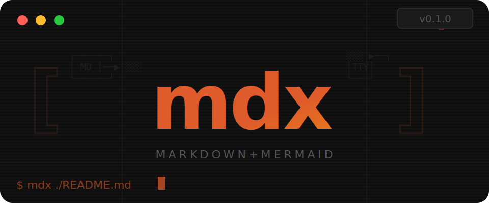
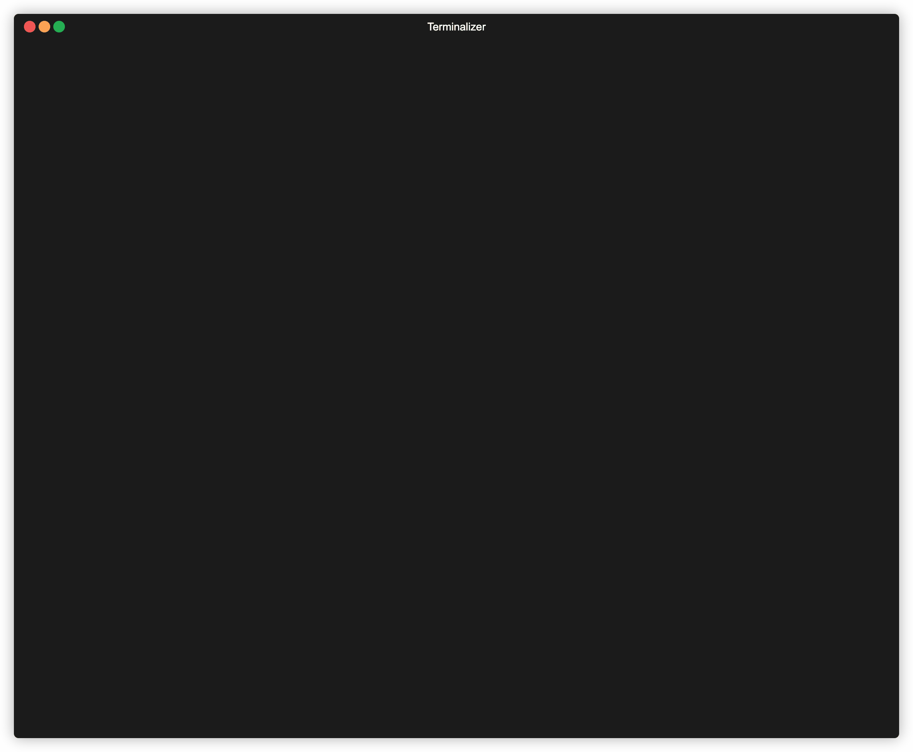

<p align="center">
  
</p>

# mdx

[](https://crates.io/crates/mermd)
[](https://crates.io/crates/mermd)
[](https://github.com/aleandros/mdx/actions/workflows/ci.yml)
[](https://github.com/aleandros/mdx/releases/latest)
[](LICENSE.txt)

**Read Markdown in the terminal — with Mermaid diagrams drawn as ASCII art.** Like [`glow`](https://github.com/charmbracelet/glow), but your `graph TD` blocks actually render.

<p align="center">
  
</p>

## Quick start

```bash
# Install
curl -fsSL https://raw.githubusercontent.com/aleandros/mdx/main/install.sh | sh

# Render a file
mdx README.md

# Or pipe anything
cat CHANGELOG.md | mdx
```

The installer detects your OS and architecture and drops the binary in `/usr/local/bin` (or `~/.local/bin` as a fallback).

## What you get

- **Mermaid as ASCII** — flowcharts and sequence diagrams rendered inline, no browser required
- **ER diagrams** — entity tables with PK/FK attributes, wrapped comments, ASCII crow's foot cardinality, identifying / non-identifying relationships
- **Interactive pager** — vim-style keybindings, search, tab-through diagrams, expand on demand
- **Embeddable** — `mdx embed` gives you a bounded ANSI stream for other TUIs
- **Themes** — 11 UI themes with a high-contrast [Nord](https://www.nordtheme.com) default, syntect-powered syntax highlighting, project- and user-level config
- **Watch mode** — `mdx -W file.md` re-renders on save

> **Diagram support is scoped.** Today mdx renders `graph` / `flowchart`, `sequenceDiagram`, and `erDiagram`. Class, state, gantt, and other types are not yet supported — PRs welcome.

## Graphics

mdx decides at startup whether the terminal can show pixel graphics. It turns
graphics on only in the interactive pager, in kitty 0.28 or later, outside tmux.
With graphics on, local PNG, JPEG and GIF images (``) show
inline, scaled to the content column; everywhere else they stay a text
placeholder. Mermaid diagrams are drawn as images too, with real shapes and
arrowheads, in exactly the cells their ASCII form takes; until the image is
ready, and wherever graphics are off, they stay ASCII. Piped output and `mdx embed` never use graphics and never query
the terminal. Turn graphics off with the CLI flag (which wins),
the environment, or the config file:

```bash
mdx --graphics off README.md
MDX_GRAPHICS=off mdx README.md
```

```toml
# ~/.config/mdx/config.toml or .mdx.toml
graphics = "off"
```

`mdx --debug-graphics` prints the decision and the reason. See
[docs/USAGE.md](docs/USAGE.md#graphics) for the detection rules.

## Why

Markdown is everpresent in my day to day workflow, and `glow` spoils you — until the doc hits a Mermaid block and you're back to squinting at raw source or alt-tabbing to a browser. mdx is the fix: same "just read this thing" ergonomics, but diagrams render where you already are.

## Docs

Full CLI reference, config, themes, embedding contract, and mermaid syntax: **[docs/USAGE.md](docs/USAGE.md)**.

## Building from source

```bash
git clone https://github.com/aleandros/mdx.git
cd mdx
cargo build --release
# Binary at target/release/mdx
```

## Testing

Run `cargo fmt --check`, `cargo clippy --all-targets --all-features -- -D warnings`, and
`cargo test`. Clippy uses the [BeautifulRust lint set](https://github.com/morganlinton/BeautifulRust/tree/main/lints),
with library-only documentation and printing rules omitted for this CLI. Keep
exceptions local with `#[expect(clippy::lint_name, reason = "...")]`; stale
expectations fail CI too. Shared generators live in `src/strategies.rs`; new properties
should reuse them. Defaults are 32–64 cases per property to keep CI fast.

```bash
# Replay committed regressions plus the default random cases
cargo test property_
# Stress all properties and the pager state machine
PROPTEST_CASES=2000 cargo test property_
# Reproduce a particular random run (also copy any saved regression seed)
PROPTEST_CASES=2000 PROPTEST_RNG_SEED=42 cargo test property_pager_model
```

Commit new `proptest-regressions/` entries with the fix, keeping the minimized
counterexample in the seed comment. Proptest replays saved seeds before new
cases. The parser oracle compares generated visible payload (not Markdown
syntax or URL metadata); arbitrary Unicode also gets a separate panic check.
Wrapping preserves non-whitespace characters and their styles, allowing an
indivisible two-cell glyph on a one-column terminal. Rigid diagram rows remain
horizontally scrollable. Embed clipping enforces the strict requested width,
including width 1; truncation retains a styled prefix, not all source text.
`render_blocks` produces logical lines, and width bounds are checked at the
wrapping/clipping boundaries that consume them.

Graphics follow-up for [#9](https://github.com/aleandros/mdx/issues/9) and
[#10](https://github.com/aleandros/mdx/issues/10). Inline images (#16) and
diagram images (#10) are covered:

- [ ] Feed the shared Markdown, diagram and pager generators to the Kitty backend.
- [x] Check each image placement reserves its assigned cell rectangle (diagrams
  take exactly their ASCII rows and columns; node labels stay inside their
  shapes across the example corpus).
- [x] Check U+10EEEE placeholder rows have exactly the reserved width.
- [x] Check graphics-off, non-TTY and embed output keep the ASCII image placeholder.

## License

MIT — see [LICENSE.txt](LICENSE.txt).

mdx bundles the DejaVu Sans Mono font for diagram labels; see
[assets/fonts/DejaVuSansMono-LICENSE.txt](assets/fonts/DejaVuSansMono-LICENSE.txt)
for its license.
