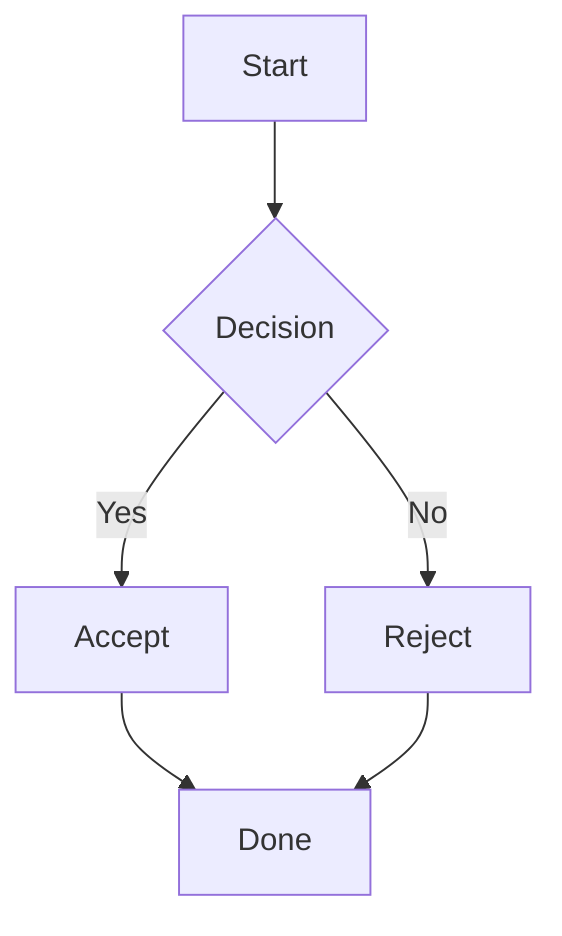
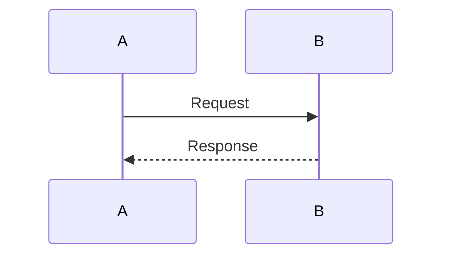
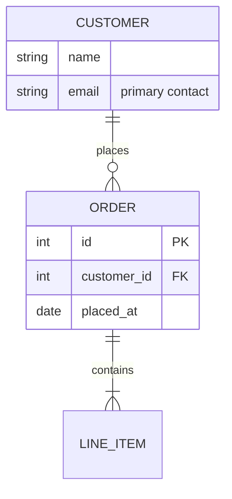

# mdx Usage

Full reference for the `mdx` CLI. For a quick overview see the [README](../README.md).

## Commands

```bash
mdx [FILE] [OPTIONS]     # Render a markdown file (or stdin)
mdx embed [FILE]         # Render a bounded ANSI stream for embedding in other TUIs
mdx update               # Update mdx to the latest release
mdx init                 # Write a default config to ~/.config/mdx/config.toml
mdx preview-themes       # Preview all available UI themes with sample markdown
```

## Rendering markdown

```bash
# Render a file
mdx README.md

# Pipe from stdin
cat README.md | mdx

# Force plain output (no interactive pager)
mdx README.md --no-pager

# Force pager mode even when piped
mdx README.md --pager

# Override terminal width
mdx README.md --width 120

# Watch a file and re-render live on change
mdx -W README.md
```

### Math

Inline math such as `$a^2$` is displayed as raw source with its dollar
delimiters: it stays in the text and uses inline-code styling, and line breaks
inside it become spaces. Display math (`$$...$$`) appears in a separate block
without syntax highlighting. This raw-source form works in the pager, plain
stdout and `mdx embed`.

With [graphics](#graphics) on, the pager typesets display math as an image
instead (see [Display math as images](#display-math-as-images)).

### Flags

| Flag | Description |
|------|-------------|
| `-p`, `--pager` | Force pager mode even when piped |
| `--no-pager` | Force plain output even on a TTY |
| `-W`, `--watch` | Watch the file and re-render on change |
| `-w`, `--width <N>` | Override terminal width for wrapping |
| `--max-width <N>` | Cap the pager's content column; wider terminals center the content between margins. `0` disables the cap (default: 100) |
| `--theme <NAME>` | Syntax highlighting theme for code blocks (default: `Nord`; use `list` to see options) |
| `--ui-theme <NAME>` | UI theme for headers, text, chrome (default: `nord`; use `list` to see options) |
| `--config <PATH>` | Use a specific config file (overrides user/project config) |
| `--no-mermaid-rendering` | Show raw mermaid source without rendering |
| `--split-mermaid-rendering` | Show mermaid source followed by the rendered diagram |
| `--graphics <auto\|off>` | Pixel graphics in the pager (default: `auto`); see [Graphics](#graphics) |
| `--mermaid-graphics <on\|off>` | With graphics on, start Mermaid diagrams as images (`on`, default) or ASCII (`off`); `i` switches one diagram. Overrides `mermaid_graphics` in the config; see [Image or ASCII](#image-or-ascii) |
| `--debug-graphics` | Print whether graphics would be enabled, and why, then exit |

## Graphics

mdx decides once, at startup, whether it may draw pixel graphics. With
graphics on, the pager shows local images inline (see
[Inline images](#inline-images)), draws Mermaid diagrams as images (see
[Diagrams as images](#diagrams-as-images)) and typesets display math (see
[Display math as images](#display-math-as-images)).

| Source | Example |
|--------|---------|
| CLI flag (wins) | `--graphics off` |
| Environment | `MDX_GRAPHICS=off` |
| Config file | `graphics = "off"` |
| Default | `auto` |

An invalid `MDX_GRAPHICS` value is ignored with a warning.

`auto` turns graphics on only when all of these hold:

1. Output is the interactive pager (or watch mode) on a terminal. Plain or
   piped output and `mdx embed` never use graphics and never send a terminal
   query, whatever the setting.
2. The terminal answers a Kitty graphics protocol query before its primary
   device attributes (DA1) reply. mdx reads until DA1 arrives, which takes
   milliseconds; a terminal that never answers gives up after 1 s (2 s over
   SSH) and means no graphics. Waiting for DA1 keeps a slow reply from
   reaching the pager as keystrokes.
3. The terminal's `XTVERSION` identifies kitty 0.28+ or Ghostty 1.0+.
   Both `name(version)` and `name version` replies are accepted. Older versions
   stay off, and `--debug-graphics` names the detected and required versions.
   Ghostty's minimum is source-backed, with [live verification pending](graphics-verification.md).
4. Inside tmux (`TMUX` is set), tmux can pass graphics through to the
   terminal outside it; see [tmux](#tmux) for the extra conditions.

mdx also records the terminal cell size in pixels, from `CSI 16 t` or the
`TIOCGWINSZ` pixel fields.

To see the decision and the reason, run the check from the terminal in question:

```bash
mdx --debug-graphics
```

```
graphics: on
reason: terminal supports Kitty graphics with Unicode placeholders
setting: auto (from default)
query: OK
terminal: kitty(0.35.2)
cell size: 10x20 px
tmux: no
```

### tmux

tmux does not speak the Kitty graphics protocol itself, but tmux 3.3 and later
can pass escape sequences through to the terminal outside it. Turn that on in
`~/.tmux.conf`:

```tmux
set -g allow-passthrough on
```

Inside tmux, `auto` turns graphics on only when all of these hold, in
addition to the first rule above:

1. tmux is 3.3 or later and `allow-passthrough` is `on` or `all` for the pane.
2. tmux sends 24-bit color to the outer terminal, because the image id
   travels in the text color: the client has the `RGB` terminal feature, or
   its terminal description has `setrgbf` and `setrgbb`. tmux usually
   detects it; if not, add `set -as terminal-features ",xterm-kitty:RGB"`.
3. tmux reports the outer terminal (`client_termtype`, from its `XTVERSION`
   reply) as one with verified Unicode placeholder support, i.e. kitty 0.28
   or later.
4. mdx's pane is the active pane of the window the client shows. tmux hands
   the terminal's reply to the active pane, so from any other pane the reply
   would be typed into another program; mdx then leaves graphics off.
5. The Kitty graphics query, sent in a passthrough sequence, is answered
   through tmux within 1 s (2 s over SSH). tmux answers DA1 itself, so mdx
   waits for the graphics reply instead.

Ghostty inside tmux is not enabled. Its direct-terminal support does not extend
the kitty-only tmux check.

mdx reads these settings with `tmux display-message` (and `tmux
show-messages -T` for the terminal description) and shows them, and the
reason when graphics stay off, in `--debug-graphics`. When `TMUX` is set but
names a pane on another tty, as in a terminal started from a tmux shell, mdx
queries its own terminal directly.

```
graphics: off
reason: tmux allow-passthrough is off (set -g allow-passthrough on)
setting: auto (from default)
query: not sent
terminal: kitty(0.35.2)
cell size: unknown
tmux: yes, version 3.4, allow-passthrough off, 24-bit color yes, active pane yes
```

With graphics on, only image data and placements go through passthrough; the
placeholder cells are ordinary text that tmux stores and redraws itself, so
images scroll with the pane and come back after switching windows. Known
limits:

- Images stay in the outer terminal's memory while you switch tmux windows,
  sessions or panes, and are deleted when mdx exits.
- With `allow-passthrough on`, tmux drops passthrough from panes that are not
  visible. An image that finishes loading or changes (watch mode) while the
  pane is hidden stays blank until it is sent again; `allow-passthrough all`
  avoids that.
- A reply slower than the timeout (1 s, 2 s over SSH) reaches the pager as
  keystrokes, because inside tmux the graphics reply is the only end marker.
- Splitting or zooming the pane resizes it, and images are fitted to the new
  size.
- With several tmux clients attached, mdx checks one client's terminal, and
  tmux passes the images to every client showing the pane.

### Inline images

With graphics on, `` images show inline in the pager, drawn with
Kitty Unicode placeholders, so they scroll with the text:

- **Local files only.** The path is relative to the markdown file's directory
  (the current directory for stdin), absolute, or a `file://` URL. Remote URLs
  (`http://`, `https://`, `data:`) keep the text placeholder.
- **Formats:** PNG, JPEG and GIF (first frame). A missing file or another
  format keeps the text placeholder.
- **Size:** the natural size, scaled down (never up) to the content column and
  to 60% of the pager height, keeping the aspect ratio. Resizing the terminal
  fits the image again.
- Images decode on a background thread; the text placeholder shows until the
  image is ready. The alt text stays below the image as a caption, so search
  finds it, and `Tab` / `Enter` select and open the image as before.
- Watch mode checks image files once a second and sends an image again only
  when its file's modification time has changed. On exit mdx deletes its
  images from the terminal.
- Only regular files are read, and decoding is capped at 16384 px a side and
  256 MiB.

Plain or piped output, `mdx embed`, `--graphics off` and `NO_COLOR` (the image
id travels in the text color, which `NO_COLOR` removes) print images as
`[Image: alt](url)`, as before.

### Diagrams as images

With graphics on, flowcharts, ER diagrams and sequence diagrams are drawn as
images instead of box-drawing characters: real rectangles, rounded boxes,
stadiums, diamonds and hexagons, polyline edges with arrowheads, crow's-foot
cardinality marks, dashed lifelines and activation bars. The same layout
drives both forms, so:

- **Same cells.** The image takes exactly the rows and columns the ASCII
  diagram would. Collapsing, `Enter` to expand, horizontal scrolling and search
  work as before; search matches the diagram's text.
- **Labels fit.** Each word of a label is fitted to the cells the layout
  reserved for it, so no font makes a label overflow its shape. Labels use the
  bundled DejaVu Sans Mono; system fonts fill in glyphs it lacks (CJK, emoji).
- **Theme colors.** Lines, boxes and text use the UI theme (including custom
  themes) and the diagram's own `style` / `classDef` / `linkStyle` colors. The
  background stays transparent.
- Diagrams rasterize on the same background thread as images, and the ASCII
  diagram shows until the image is ready. Rasterized diagrams are cached by
  source, width, theme and cell size, so scrolling, resizing back and watch
  mode reloads of unchanged diagrams do not draw them again.
- A diagram that cannot be drawn, or that is wider or taller than 297 cells
  (the most a placement can address), stays ASCII. Parse errors show the
  source with a warning, as before.

Plain or piped output, `mdx embed`, `--graphics off` and `NO_COLOR` keep the
ASCII diagrams, byte for byte.

#### Image or ASCII

The ASCII form stays available, because its text can be selected and copied
in the terminal, and the image cannot. Diagrams start as images; start them as
ASCII with `--mermaid-graphics off` or `mermaid_graphics = "off"` in the config
(the flag wins).

With graphics on, every diagram can be selected (`Tab`, or by scrolling it into
view), and `i` switches the selected one between its image and its ASCII form.
The blank row above the selected diagram (or below it, when the row above is
scrolled out of view) says which form it is in, for
example `[image — i for ASCII]` or `[ASCII — i for image]` (`image loading`
while it rasterizes, `image unavailable` when it cannot be drawn). The two forms
take the same rows, so switching never moves the content above it. A collapsed
diagram stays collapsed and shows the chosen form once expanded. The choice is
kept per diagram across scrolling, resizing and watch-mode reloads, like
expanded diagrams. `Enter` still only expands and collapses large diagrams.
Without graphics, `i` does nothing and no hint is shown.

Search always matches diagram text. When `/`, `?`, `n` or `N` lands on a match
inside a diagram shown as an image, that diagram switches to ASCII so the match
is visible; press `i` to go back to the image.

### Display math as images

With graphics on, each display math block (`$$...$$`) is typeset with
[RaTeX](https://github.com/erweixin/RaTeX), which follows KaTeX's layout and
uses the KaTeX fonts (embedded in mdx, so nothing needs installing).
Fractions, sums and integrals with limits, matrices (`pmatrix`, `bmatrix`,
`vmatrix`), `aligned`, `cases`, accents and the usual symbol fonts all work;
[docs/examples/math-display.md](examples/math-display.md) is a sample.

- **Sized to the text.** One em is 0.8 of a cell's height, about the size of
  the surrounding text. The formula takes as many rows as its height needs,
  and is centered in the content column.
- **Theme colors.** Glyphs use the UI theme's body text color (`\color` in the
  formula still applies), on a transparent background.
- **Search.** The image's first row carries the formula's source, so `/`
  finds display math by its TeX.
- Formulas typeset on the same background thread as images; the source shows
  until the image is ready. Typeset formulas are cached by source, theme and
  cell size.
- A formula that does not typeset (invalid or unsupported TeX), one that needs
  a glyph the KaTeX fonts lack (such as non-Latin text in `\text{}`, or
  emoji), one longer than 16 KiB of source or larger than 4096 pixels, or one
  that would have to shrink below half its size to fit the content column
  keeps its raw source, as above; so does a formula with nothing to draw
  (only spaces or `\phantom`). A narrower content column scales wider
  formulas down.

Inline math (`$...$`) and display math inside list items stay raw source.
Plain or piped output, `mdx embed`, `--graphics off` and `NO_COLOR` show the
raw source.

## Interactive pager

When the output is a TTY, mdx launches an interactive pager with vim-style keybindings.

**Scrolling**

| Key | Action |
|-----|--------|
| `j` / `k` / arrow keys | Scroll one line |
| `Space` / `Page Down` | Page down |
| `Page Up` | Page up |
| `Ctrl-d` / `Ctrl-u` | Half-page down / up |
| `Ctrl-f` / `Ctrl-b` | Full page down / up |
| `g` / `Home` | Go to beginning |
| `G` / `End` | Go to end |
| `h` / `l` / Left / Right | Horizontal scroll |
| Mouse scroll | Scroll (3 lines) |

**Search**

| Key | Action |
|-----|--------|
| `/` | Forward search |
| `?` | Backward search |
| `n` | Next match |
| `N` | Previous match |

**Diagrams & images**

| Key | Action |
|-----|--------|
| `Tab` / `Shift-Tab` | Cycle through diagrams/images |
| `Enter` | Expand/collapse diagram, open image (local paths open from the markdown file's directory) |
| `i` | Switch the selected diagram between image and ASCII (graphics on only; see [Image or ASCII](#image-or-ascii)) |

**General**

| Key | Action |
|-----|--------|
| `q` / `Esc` | Quit |

Large diagrams are collapsed by default and can be expanded with `Enter`.

**Margins on wide terminals**

The pager caps the content column at 100 columns (`--max-width`, or
`max_width` in the config file) and centers it, so prose on a wide terminal
reads like a page instead of stretching edge to edge. Diagrams that fit the
column share its left margin; wider ones are centered on the full terminal if
they fit it, and otherwise start at column 0 and can be scrolled horizontally.
Set `--max-width 0` to always use the full terminal width.

## Embedding in other programs

Use `mdx embed` when another program needs the rendered output as a bounded ANSI stream. It never opens a pager, never touches the alternate screen, and always emits ANSI color (set `NO_COLOR` to disable).

```bash
# Render into a 40-column, 10-row box (caller handles scrolling)
mdx embed --width 40 --height 10 README.md

# From stdin
cat README.md | mdx embed --width 60

# Drop color for plain output
NO_COLOR=1 mdx embed --width 40 README.md
```

**Output contract**

- Every line ends with `\n`; each line's display width ≤ `--width`.
- Total lines ≤ `--height` when provided.
- No pager, no alt-screen, no terminal escape sequences other than SGR color/style.
- Mermaid diagrams wider than `--width` are cropped (not reflowed).

### Embed flags

| Flag | Description |
|------|-------------|
| `-w`, `--width <N>` | Output width; each line is cropped to fit |
| `--height <N>` | Maximum number of output lines |
| `--theme <NAME>` | Syntax highlighting theme |
| `--ui-theme <NAME>` | UI theme |
| `--config <PATH>` | Use a specific config file |
| `--no-mermaid-rendering` | Raw mermaid source only |
| `--split-mermaid-rendering` | Mermaid source followed by rendered diagram |

## Configuration

mdx reads configuration from TOML files in this order (later entries override earlier ones):

1. **User config** — `$XDG_CONFIG_HOME/mdx/config.toml` (falls back to `~/.config/mdx/config.toml`)
2. **Project config** — `.mdx.toml` at the nearest ancestor directory containing `.git`
3. **`--config <PATH>`** — if passed, this file is loaded exclusively; user and project configs are ignored
4. **CLI flags** — always win

Generate a commented template with:

```bash
mdx init
```

### Keys

```toml
# Syntax highlighting theme for code blocks (default: "Nord")
theme = "Nord"

# UI theme for headers, text, and chrome (default: "nord")
ui_theme = "nord"

# Force pager mode
pager = false

# Terminal width override (omit to use terminal width)
width = 100

# Pager content width cap; wider terminals center the content between
# margins. 0 disables the cap.
max_width = 100

# Mermaid diagram rendering
no_mermaid_rendering = false
split_mermaid_rendering = false

# Pixel graphics in the pager: "auto" or "off" (see Graphics)
graphics = "auto"

# Mermaid diagrams with graphics on: "on" (images) or "off" (ASCII);
# i switches one diagram in the pager
mermaid_graphics = "on"
```

## Themes

### UI themes

Control colors for headers, text, links, and pager chrome.

```
nord (default)   clay   hearth   frost   glacier   steel
solarized-dark   solarized-light   paper   snow   latte
```

The default `nord` theme uses the official [Nord palette](https://www.nordtheme.com/docs/colors-and-palettes).
Against the nord0 background (`#2E3440`), every color it uses has a WCAG contrast
ratio of at least 4.5:1. Unlike the other themes, it doesn't dim inline code or
horizontal rules.

Before 0.1.15 the default was `clay` with the `base16-ocean.dark` syntax theme.
To keep that look, select both by name:

```bash
mdx --ui-theme clay --theme base16-ocean.dark README.md
```

```toml
# ~/.config/mdx/config.toml
ui_theme = "clay"
theme = "base16-ocean.dark"
```

The syntax theme default doesn't follow `ui_theme`. If you set only `ui_theme`,
for example to a light theme such as `paper`, code blocks now use `Nord`. Add
`theme = "base16-ocean.dark"` (or `InspiredGitHub` for light backgrounds) to choose
the code colors explicitly.

Preview them all against sample markdown:

```bash
mdx preview-themes
```

### Syntax highlighting themes

Applied to fenced code blocks. Powered by [syntect](https://github.com/trishume/syntect). The default is `Nord`, bundled from [nordtheme/sublime-text](https://github.com/nordtheme/sublime-text) (MIT) with its comment color lightened to reach 3:1 contrast. syntect's `base16-*`, `Solarized (dark)`, `Solarized (light)` and `InspiredGitHub` themes are also built in.

```bash
mdx --theme=list           # List available syntax themes
mdx --ui-theme=list        # List available UI themes
```

### Custom themes

Add your own themes without recompiling, by dropping files into your config directory. Both are picked up automatically and show up in `--ui-theme=list` / `--theme=list`.

**UI themes** — create `$XDG_CONFIG_HOME/mdx/themes/<name>.toml` (falls back to `~/.config/mdx/themes/`). Colors are `"#rrggbb"` hex strings:

```toml
# ~/.config/mdx/themes/dracula.toml
heading = [
  "#ff79c6", # H1
  "#bd93f9", # H2
  "#8be9fd", # H3
  "#50fa7b", # H4
  "#ffb86c", # H5
  "#6272a4", # H6
]
body = "#f8f8f2"
bold = "#f8f8f2"
italic = "#f8f8f2"
link = "#8be9fd"
inline_code = "#50fa7b"
horizontal_rule = "#6272a4"
diagram_border = "#bd93f9"
diagram_collapsed = "#8be9fd"
diagram_node_fill = "#bd93f9"
diagram_node_border = "#ff79c6"
diagram_node_text = "#f8f8f2"
diagram_edge_stroke = "#50fa7b"
diagram_edge_label = "#ffb86c"
# Optional: also dim inline code and horizontal rules (default: true)
dim_muted = true
```

Select it the same way as a built-in theme: `mdx --ui-theme dracula` or `ui_theme = "dracula"` in `config.toml`. Built-in theme names take precedence if there's a name collision. Malformed files produce a clear error naming the bad field.

**Syntax themes** — drop a standard TextMate/Sublime `.tmTheme` file into `$XDG_CONFIG_HOME/mdx/syntax-themes/` (falls back to `~/.config/mdx/syntax-themes/`). It's keyed by filename, e.g. `Dracula.tmTheme` is selected with `--theme Dracula`.

## Mermaid diagrams

Fenced code blocks tagged `mermaid` are rendered as ASCII art.

> **Supported today:** `graph` / `flowchart`, `sequenceDiagram`, and `erDiagram`. Other diagram types (class, state, gantt, etc.) are not yet supported.

### Flowcharts

````markdown

````

**Directions:** `graph TD` (top-down), `graph LR` (left-right), `graph BT` (bottom-top), `graph RL` (right-left)

**Node shapes:**
- `A[text]` rectangle
- `A(text)` rounded
- `A{text}` diamond
- `A((text))` circle

**Edge styles:**
- `-->` arrow
- `---` plain line
- `-.->` dotted arrow
- `==>` thick arrow

**Edge labels:** `A -->|label| B`

**Chained edges:** `A --> B --> C`

### Sequence diagrams

````markdown

````

### ER diagrams

mdx renders `erDiagram` blocks as ASCII tables linked by ASCII crow's foot
endpoints.

````markdown

````

**Supported syntax**

- **Header:** `erDiagram`
- **Direction (extension):** `direction TD` / `direction LR`. Without one, mdx
  tries `LR` first and falls back to `TD` if the laid-out width exceeds the
  terminal width.
- **Relationships:** `LEFT <lcard> <op> <rcard> RIGHT [: LABEL]`
  - `<op>` is `--` (identifying, solid) or `..` (non-identifying, dotted).
  - `<lcard>` is one of `||`, `o|`, `}o`, `}|`.
  - `<rcard>` is one of `||`, `|o`, `o{`, `|{`.
  - `LABEL` is a quoted string or a bareword.
- **Entities:** `NAME { ... }` with one attribute per line:
  - `TYPE NAME [PK | FK | PK,FK | FK,PK] ["comment"]`
  - Long comments wrap below the attribute, aligned under the NAME column.
  - Box width is capped per terminal width; tweak by passing `--width`.

**Crow's foot glyphs**

| Cardinality   | Left   | Right  |
| ------------- | ------ | ------ |
| Exactly one   | `\|\|` | `\|\|` |
| Zero or one   | `o\|`  | `\|o`  |
| Zero or many  | `}o`   | `o{`   |
| One or many   | `}\|`  | `\|{`  |

### Styling

ER diagrams support the same `style`, `classDef`, and `class` directives
as flowcharts. Place them inside the `erDiagram` block:

```
erDiagram
    Notification ||--o{ Pref : has
    classDef audit fill:#666
    classDef config fill:#fc0
    Notification {
      string id PK
    }
    Pref {
      string id PK
    }
    class Notification config
    class Pref audit
    style Notification stroke:#f00
```

- `style ENTITY <props>` sets per-entity color. Properties: `fill`, `stroke`, `color`.
- `classDef NAME <props>` defines a reusable style.
- `class ENTITY[,ENTITY...] NAME` applies the named class to one or more entities.
- An explicit `style` line replaces any class-applied style on the same entity.
- Border cells (and crow's foot glyphs at edge endpoints) use `stroke` (or `fill` if `stroke` is not set). Inner text uses `color`.

## Updating

```bash
mdx update
```

Downloads the latest release binary and replaces the current one in place.

## Building from source

```bash
git clone https://github.com/aleandros/mdx.git
cd mdx
cargo build --release
# Binary at target/release/mdx
```
