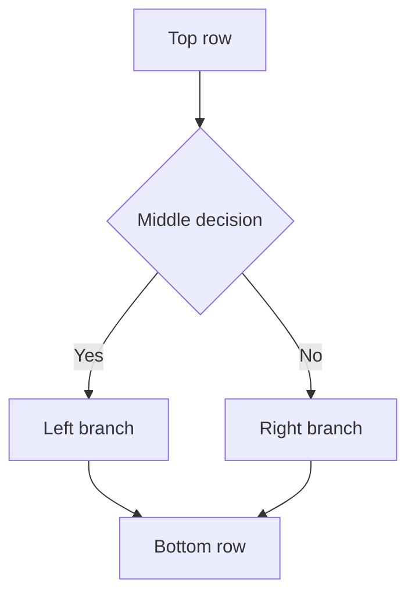
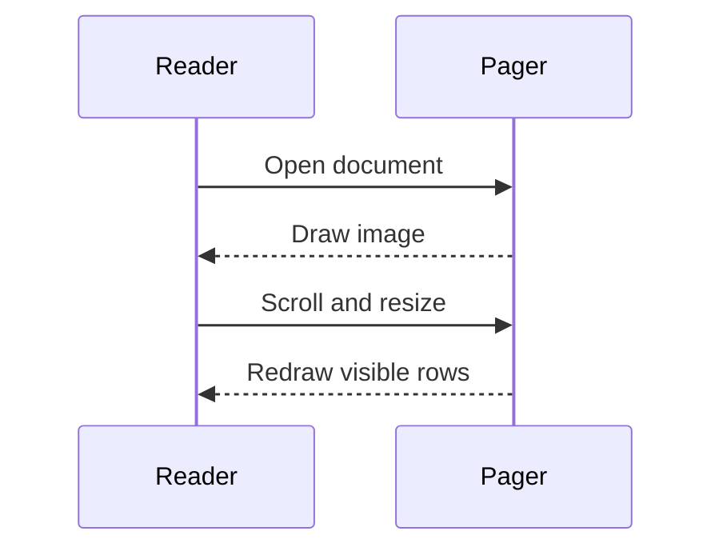
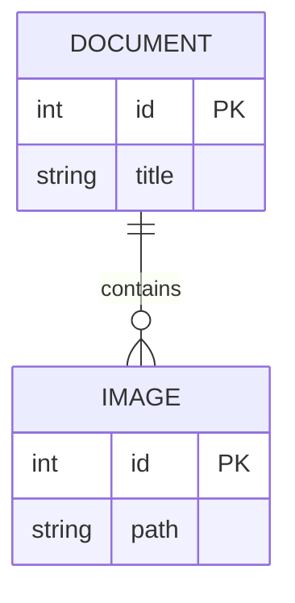

# Graphics pager checks

Use `j` and `k`, then Page Down and Page Up, to move each image across both
viewport boundaries. Resize the window while an image is partially visible.

## Local PNG

The mdx logo below should render as pixels. Its top, middle and bottom should
stay in order as it crosses the viewport boundaries.

This paragraph follows the PNG and must remain readable after scrolling and
resizing. Scroll away and return to check that the image reappears.

## Flowchart

The following diagram should have real node shapes and arrowheads. Press `i`
while the diagram is focused to compare the image with its ASCII form.

This paragraph follows the flowchart. Resize narrower and wider, then scroll
back to the diagram and check its labels and branches.

## Sequence diagram

This paragraph follows the sequence diagram. Check that clipped lifelines and
arrows return to the right positions when the whole diagram is visible again.

## Entity relationship diagram

This paragraph follows the ER diagram. Keep scrolling to move the diagram's
bottom through the top of the viewport, then return.

## Text after the images

First trailing paragraph.

Second trailing paragraph.

Third trailing paragraph.

Fourth trailing paragraph.

Fifth trailing paragraph.

Sixth trailing paragraph.

Seventh trailing paragraph.

Eighth trailing paragraph.

Ninth trailing paragraph.

Tenth trailing paragraph.
